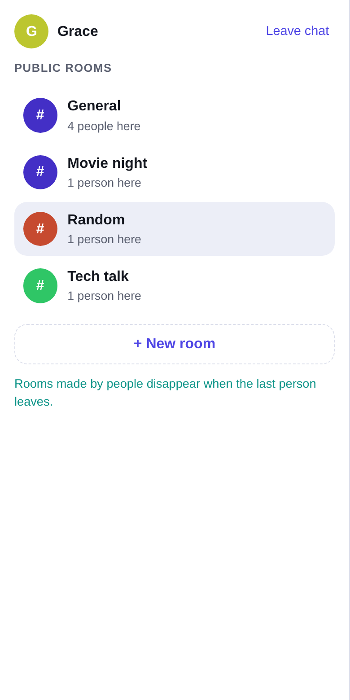
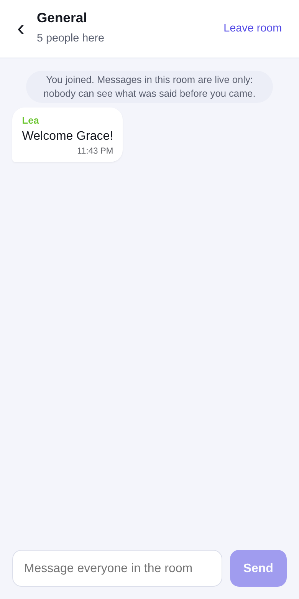
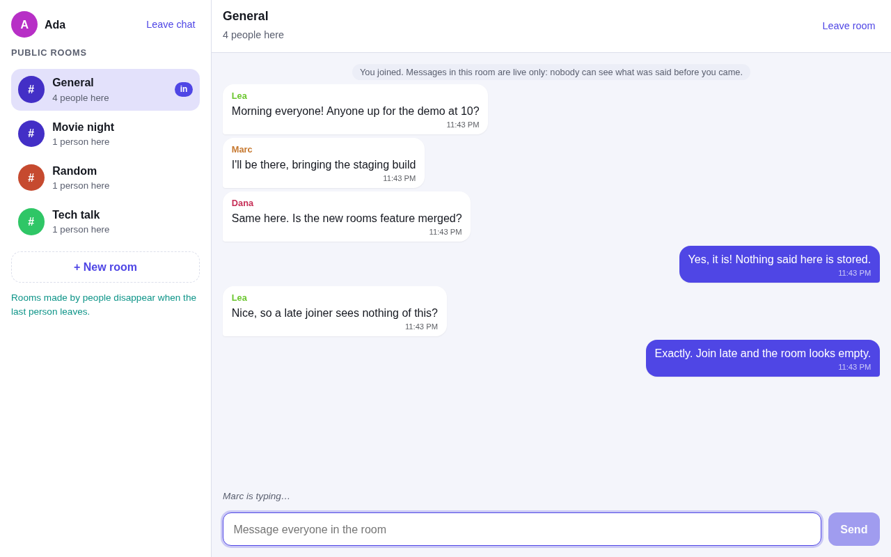

# Public chat rooms: live only (Vue 3 + Socket.IO)

Open chat rooms for anyone, with one rule: **nothing is ever stored**. A message is relayed to the people who are in the room at that moment and that is all. Join a room late, or reconnect, and it looks empty. There are no accounts: you pick a nickname and walk in.

| | | |
| :---: | :---: | :---: |
|  |  |  |



The conversation view in dark mode: [docs/screenshots/chat-dark.png](docs/screenshots/chat-dark.png).

## Features

- **Several public rooms**: General, Random and Tech talk always exist; anyone can create another one, and it disappears when the last person leaves it.
- **Who is here**: every room shows how many people are in it (updated live for everyone), and its member list. "Ada joined" / "Bob left" notices appear in the conversation.
- **Nicknames**, unique among the people online (2 to 20 characters; "ada" and "Ada" are the same).
- **Typing indicator**, message times, your own messages on the right, a colour per person.
- **Live only**: the server keeps no history, the browser stores nothing (no cookie, no local storage). Leaving a room forgets everything said in it.
- **Reconnection**: if the connection drops, the page says hello again with the same nickname and goes back into its rooms (what was said in between is lost, as it should be).
- Light and dark themes; on a phone, the room list and the conversation take turns.

## Run it

```bash
npm install
npm run build && npm start        # the server also serves the page: http://localhost:3000
```

For development, in two terminals (the page reloads as you edit):

```bash
npm run dev-server                # Socket.IO server on :3000 (restarts on change)
npm run dev                       # Vite dev server on http://localhost:5173
```

Or with Docker (page and chat in one container):

```bash
docker compose up --build         # http://localhost:3000
```

`nix develop` gives you Node 22 and Docker Compose if you use Nix.

| Variable | Default | |
| --- | --- | --- |
| `PORT` | `3000` | port of the server |
| `CORS_ORIGIN` | `http://localhost:5173,http://127.0.0.1:5173` | pages that may connect from another address (comma-separated, or `*`). Not needed when the server serves the page itself |
| `VITE_SOCKET_URL` | this site (production), `http://<host>:3000` (dev) | address of the server, set at build time |

## Rules enforced by the server

Everything the client sends is untrusted, so the server checks it (see `server/rooms.js`):

| Limit | |
| --- | --- |
| nickname | 2 to 20 letters, digits, spaces, `.`, `_`, `-`; unique among people online |
| room name | 2 to 30 characters, unique (case-insensitive); at most 50 rooms |
| message | text, 1 to 500 characters; at most 5 per 5 seconds per connection |
| room | at most 200 people; one person can be in at most 10 rooms |
| payload | anything over 10 KB is dropped by Socket.IO before it is read |

Messages are shown by Vue as text, never as HTML.

## Protocol (Socket.IO)

Client to server, each with an acknowledgement `{ ok: true, ... }` or `{ error }`:

| Event | Data | Answer |
| --- | --- | --- |
| `hello` | `{ nickname }` | `user`, `rooms` (required before anything else) |
| `rooms:list` | | `rooms` |
| `room:create` | `{ name }` | `room` |
| `room:join` | `{ room }` | `room`, `members` |
| `room:leave` | `{ room }` | |
| `message` | `{ room, text }` | `id` |
| `typing` | `{ room, typing }` | (no answer) |

Server to clients: `message` and `typing` (to the people in the room), `room:members` and `room:event` (join / leave notices, to the room), `rooms` (the list with head counts, to everybody who chose a nickname).

`GET /health` answers `{ status, online, rooms }`.

## Tests

```bash
npm test                  # 70 tests: the rules, the server with real sockets, the chat store, the components
npm run test:coverage     # with a coverage report (about 84%, 95% on the server)
npm run build             # type-checks the code and the tests, then builds
```

The server tests start a real server on a free port and connect several real clients: messages reach only the people in the room, nothing is stored (a late joiner sees nothing), the rate limit, payload and nickname checks, disconnections. The chat-store test also cuts a connection and checks that the page comes back into its rooms.

## CI/CD

`.github/workflows/main.yml` runs on every push and pull request: install (`npm ci`), build and type-check, tests with coverage (uploaded as an artifact, and to Codecov when a `CODECOV_TOKEN` secret exists), then it builds the Docker image, starts it and checks `/health`.

`docker-compose.jenkins.yaml` starts a local Jenkins (with a Docker-in-Docker service) from `jenkins.Dockerfile`, to experiment with CI/CD. It is optional and not needed to run the chat.

## Project layout

```
server.js                entry point: starts the server (and serves dist/ when it has been built)
server/rooms.js          the rules: nicknames, rooms, members, limits, rate limiter (no Socket.IO)
server/index.js          the Socket.IO server and the tiny static file server
src/composables/chat.ts  the chat on the client: connection, rooms, messages, reconnection
src/components/          NicknameForm, RoomList, ChatPanel
src/App.vue              the layout
Dockerfile               one image for the page and the server
```

## Tech stack

Vue 3 (`<script setup>`), TypeScript, Vite 7, Socket.IO 4, Node.js 22, Vitest 5 and Vue Test Utils, GitHub Actions, Docker.
