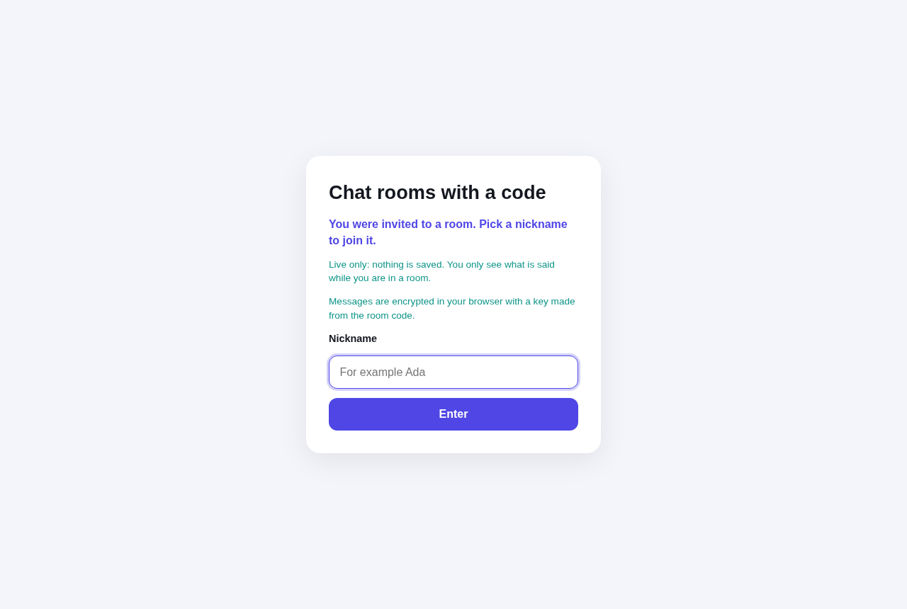
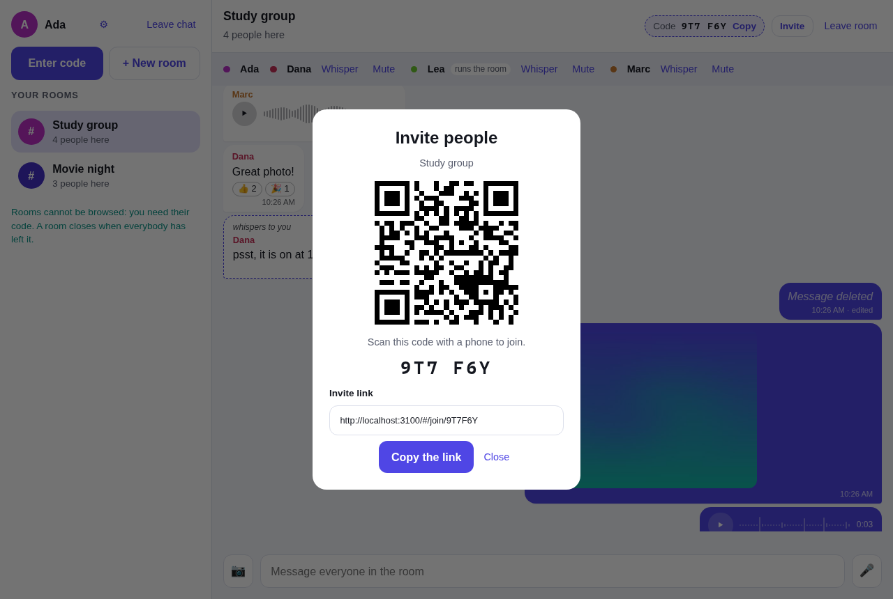
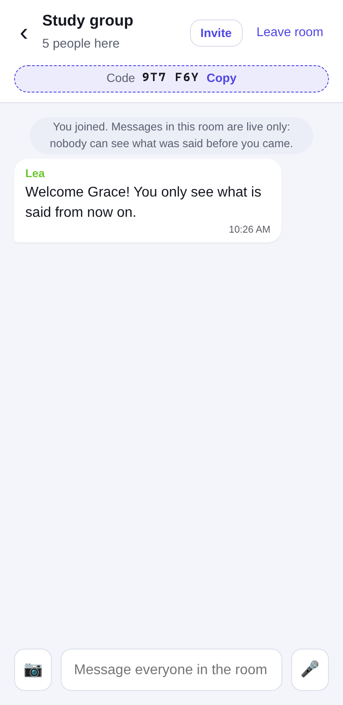
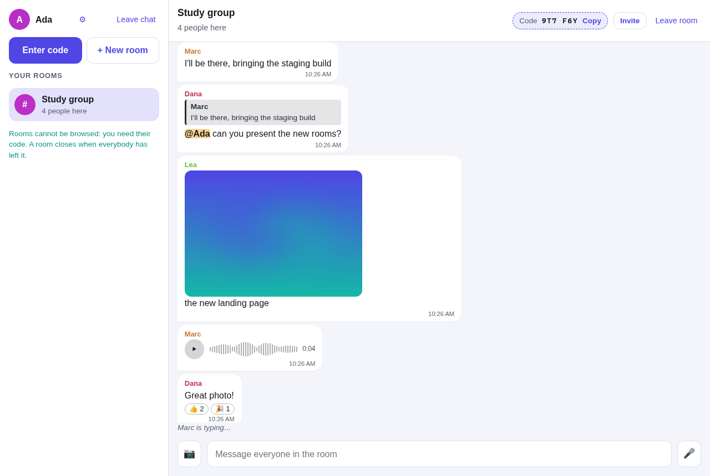

# Chat rooms joined with a code: live only (Vue 3 + Socket.IO)

Chat rooms with two rules. **A room can only be entered with its code**, and **nothing is ever stored**. A message is relayed to the people who are in the room at that moment and that is all: join late, or reconnect, and the room looks empty. There are no accounts: you pick a nickname, then create a room and share its code (or an invite link), or join one with the code you were given. What people write is **encrypted in their browser** with a key made from the room code, and the server can **run on several machines** sharing the chat through Redis.

| | | |
| :---: | :---: | :---: |
|  |  |  |



More: [recording a voice message](docs/screenshots/recording.png) · [unread counters, with a mention](docs/screenshots/unread.png) · [dark mode](docs/screenshots/dark.png) · [in French](docs/screenshots/french.png)

## What you can do

- **Rooms and codes**: create a room and you are inside, running it, with its **code** (six letters and digits such as `K7M 2QX`). Anybody who has the code can come in; nobody else can. Rooms cannot be browsed or listed.
- **Invite**: an **invite link** (`/#/join/K7M2QX`, the code is after the `#`, which browsers never send to a server) and a **QR code** to scan with a phone, with the share sheet where the browser has one. The code is taken out of the address bar as soon as the page has read it.
- **Messages**: text, **photos** (shrunk to 900 px in the browser), **voice messages** (up to 30 seconds, recorded with a **live scrolling waveform**, shown as loudness bars that fill while they play), **replies** (the quoted message is shown), **edit** and **delete** (your own), **reactions** (👍 ❤️ 😂 😮 😢 🎉), **@mentions** (highlighted, yours in a stronger colour) and **whispers** to one person (`/w Nickname message`).
- **Keeping up**: an unread counter per room (with a mark when somebody mentioned you), the count in the browser tab title, an optional beep and optional desktop notifications (which never contain what was said), "typing…", who is in the room, "joined / left" notices.
- **Running a room**: the person who runs it can **lock** it (nobody new comes in, but people who were in can come back after a connection blip), **remove** somebody (who cannot come back with the code), or make a **new code** (the old one stops working, and so does the old key). If the owner leaves, the person who has been there longest takes over. Anybody can **mute** somebody: their messages disappear from your screen only.
- **Live only**: the server keeps no history and the browser stores nothing (no cookie, no local storage). Leaving a room forgets everything said in it. A room exists while somebody is in it; if the last person was only disconnected it stays open for a minute, so a blip does not cost you your room and code.
- **Reconnection**: if the connection drops, the page says hello again with the same nickname and goes back into its rooms using their codes.
- **Installable** as an app (the page's files are kept for fast starts; never what was said), **light and dark themes**, **English and French** (the language of the browser, changeable in the settings), a layout for phones.

## Encryption, and its limit

Every message body (text, photo, voice message, edit, whisper) is encrypted in the sender's browser with AES-GCM before it leaves, with a key made from the room code (PBKDF2, 310,000 iterations), and decrypted by the others in the room. The server only relays the encrypted text and measures its size: it cannot read it, and nor can anybody who watches the network or the server's logs.

**The honest limit:** a code has 6 characters, about 30 bits. It is a password, not a strong key. Whoever records the encrypted traffic *and* then tries every possible code offline could read it (about 9 hours for the whole space on one very fast graphics card, at 10 billion PBKDF2 iterations a second). Making a new code changes the key. For secrecy against a determined attacker you would add a long secret to the invite link (after the `#`) that is never sent anywhere; the server's other protections (below) are about who can *get in*, not about this.

Photos and voice messages are checked by the page that receives them (an image must be a JPEG, PNG or WebP data URL, never an SVG or a script; audio must be a known kind): anything else is shown as "this message could not be read".

## Run it

```bash
npm install
npm run build && npm start        # the server also serves the page: http://localhost:3000
```

For development, in two terminals (the page reloads as you edit):

```bash
npm run dev-server                # Socket.IO server on :3000 (restarts on change)
npm run dev                       # Vite dev server on http://localhost:5173
```

Or with Docker (page and chat in one container): `docker compose up --build` → http://localhost:3000. `nix develop` gives you Node 22 and Docker Compose if you use Nix.

Voice messages, notifications and the installable app need a secure context: `localhost` or HTTPS.

| Variable | Default | |
| --- | --- | --- |
| `PORT` | `3000` | port of the server |
| `CORS_ORIGIN` | `http://localhost:5173,http://127.0.0.1:5173` | pages that may connect from another address (comma-separated, or `*`). Not needed when the server serves the page itself |
| `VITE_SOCKET_URL` | this site (production), `http://<host>:3000` (dev) | address of the server, set at build time |
| `REDIS_URL` | not set | with a Redis, several servers share the chat (see below) |
| `INSTANCE_ID` | random | the name of this server in a cluster |
| `MESSAGE_SECRET` | random, or shared through Redis | signs the proofs that let you edit your own messages |
| `TRUST_PROXY` | `0` | `1`: read the visitor's address from `X-Forwarded-For` (only behind a proxy that sets it itself, as `deploy/nginx.conf` does) |

## Several servers

On its own, the server keeps everything in its memory. With `REDIS_URL` it keeps *who is online and which rooms exist* in Redis instead, so that any number of servers behind a load balancer behave as one chat:

```
                         ┌─────────┐        ┌─────────────────────────────┐
 browsers ── WebSocket ─►│  nginx  │───────►│ chat1 ◄──┐       ┌──► chat2 │
                         └─────────┘        └──────────┼───────┼──────────┘
                                                       ▼       ▼
                                             Redis: nicknames, rooms, codes, who is in them (no messages)
                                                 + pub/sub that carries each message to the other servers
```

```bash
docker compose -f docker-compose.scale.yaml up --build     # Redis, two chat servers, nginx on http://localhost:8080
npm run scale-check                                         # people on different servers find each other
```

- **State in Redis**: each change that must not be interrupted (taking a nickname, entering a room that has one place left, closing a room when its last person leaves, handing a room to somebody else) is a **Lua script**, which Redis runs as one step: two servers can never give the same nickname or the same code, or overfill a room. Messages are never written to Redis: they go through its pub/sub (the Socket.IO Redis adapter) and are gone once delivered.
- **Any server takes any visitor**: the page uses WebSockets only, so the load balancer needs no sticky sessions.
- **Wrong codes are counted across servers**, so trying one guess on each server in turn does not help.
- **A server that dies** (killed, crashed, machine lost) would leave its people "online" for ever. Every server refreshes a heartbeat key that expires; the others notice a missing one, remove that server's people, free their nicknames and tell the rooms ("Bob left", a new owner if needed). In the Docker test, a killed server was noticed after about 12 seconds. nginx gives up on a dead server after 2 seconds, so visitors are not kept waiting.
- **No stale state**: every change of a room (somebody joins or leaves, a lock, a new code, a new owner) raises a revision number that travels with the room's description. Two servers announcing at nearly the same moment can deliver their messages in either order, so a page ignores any description older than the one it has. (A test in this repo failed about one run in four before this was added: a join announcement, computed a moment before a lock, arrived after it and undid it on screen.)
- **Proofs are shared**: the secret that signs the right to edit a message is made by the first server and read from Redis by the others (or set with `MESSAGE_SECRET`), so you can reconnect to another server and still edit your message.
- **Not done**: Redis itself is a single point of failure (use a managed or replicated Redis for that); and the rooms are in one Redis, which is the limit of this design.

## Rules enforced by the server

Everything the client sends is untrusted, so the server checks it (see `server/rooms.js`). Every refusal has a stable `code`, which is how the page shows it in French or English.

| | |
| --- | --- |
| room code | 6 characters from 32 (no `0/O` or `1/I`): about a billion codes, chosen at random, unique among open rooms |
| wrong codes | 10 per address every 5 minutes, then even the right code is refused until the window passes: two guesses a minute against a billion codes. The limit is shared by all servers; behind a proxy set `TRUST_PROXY=1` so that each visitor has their own |
| nickname | 2 to 20 letters, digits, spaces, `.`, `_`, `-`; unique among people online (across servers) |
| room name | 2 to 30 characters; two rooms can share a name, their codes tell them apart; at most 200 rooms |
| message | the server cannot read it, so it measures it: up to 6,000 characters of encrypted text (500 characters), or 450 KB for a photo or voice message. Text: 5 per 5 seconds per connection; photos and voice: 3 per 10 seconds |
| edit and delete | only the author: the server gives the sender a signed **proof** with each message (never relayed to others); edit and delete must present it |
| reactions, whispers | reactions from the fixed list only; a whisper only to somebody who is in the room |
| room | at most 200 people; one person can be in at most 10 rooms; only the owner locks, removes or changes the code |
| payload | anything over the largest allowed message is dropped by Socket.IO before it is read |

Messages are shown by Vue as text, never as HTML. `/health` shows only how many people and rooms there are, never names or codes.

## Protocol (Socket.IO)

Client to server, each with an acknowledgement `{ ok: true, ... }` or `{ error, code, params }`:

| Event | Data | Answer |
| --- | --- | --- |
| `hello` | `{ nickname }` | `user`, `instance` (required before anything else) |
| `room:create` | `{ name }` | `room` (with its `code`), `members`: you are inside, and run it |
| `room:join` | `{ code }` | `room`, `members` |
| `room:leave` | `{ room }` | |
| `message` | `{ room, body, replyTo? }` | `id`, `at`, `proof` |
| `message:edit` / `message:delete` | `{ room, id, proof, body? }` | |
| `message:react` | `{ room, id, emoji, on }` | |
| `whisper` | `{ room, to, body }` | `id` |
| `room:lock` / `room:kick` / `room:newcode` | `{ room, locked }` / `{ room, id }` / `{ room }` | `room` |
| `typing` | `{ room, typing }` | (no answer) |

`body` is the encrypted text. Server to the people in a room: `message`, `message:edited`, `message:deleted`, `message:reaction`, `typing`, `room:members`, `room:event` (join / leave / kick / owner notices), `room:updated` (head count, lock, owner, code, and a revision `rev`); to one person: `whisper`, `room:kicked`. `GET /health` answers `{ status, instance, online, rooms }`.

## Tests

```bash
npm test                        # 208 tests without Redis (43 more are skipped)
REDIS_URL=redis://localhost:6379 npm test   # 251 tests, with the Redis registry and two real servers
npm run test:coverage           # with a coverage report (about 83%, 97% on the server)
npm run build                   # type-checks the code and the tests, then builds
```

- **The rules** (`server/rooms.js`) and the **Redis registry** (`server/redis.js`) are tested by *one* list of tests (`registry.contract.js`) run against both, so they cannot disagree.
- **The server** is tested with real sockets: a room cannot be entered without its code, nothing is stored, edit and delete need the proof, reactions, whispers, owner tools, rate limits, payload limits, brute-forcing codes, addresses behind a proxy.
- **A cluster** is tested with two real servers on one Redis: people on different servers share nicknames, rooms, messages, whispers and typing; the owner's tools work across servers; wrong codes are counted together; a server that "crashes" is cleaned up after.
- **The client**: the chat store against the real server (end to end, with real encryption: a bare connection in the room only ever sees ciphertext), every component, the encryption, the translations (French has every sentence English has, and **every refusal code the server can make is translated**), and the parsing of mentions, whispers and invite links.
- The whole flow was also driven in a real browser (invite link, photo, voice with a fake microphone, QR code, unread counters, French, phone layout), which is how the screenshots above were made.

## CI/CD

`.github/workflows/main.yml` runs on every push and pull request: install (`npm ci`), build and type-check, **all the tests against a Redis service**, with coverage (uploaded as an artifact, and to Codecov when a `CODECOV_TOKEN` secret exists); then it builds the Docker image and checks `/health`; then it starts **Redis, two servers and nginx** and runs `npm run scale-check`.

`docker-compose.jenkins.yaml` starts a local Jenkins (with a Docker-in-Docker service) from `jenkins.Dockerfile`, to experiment with CI/CD. It is optional and not needed to run the chat.

## Project layout

```
server.js                 entry point: one server, or one of a cluster when REDIS_URL is set
server/rooms.js           the rules: nicknames, rooms, codes, owners, limits, rate limiters (in memory)
server/redis.js           the same registry on Redis (Lua scripts), the shared counter, heartbeat and janitor
server/index.js           the Socket.IO server, the tiny static file server, /health
server/proof.js           the signed proofs that let you edit your own messages
src/composables/chat.ts   the chat on the client: connection, rooms, encryption, messages, reconnection
src/crypto.ts, media.ts   encryption with the room code; photos and voice recording
src/components/           NicknameForm, RoomList, ChatPanel, MessageItem, Composer, InviteDialog, WaveBars
src/i18n.ts               English and French
public/                   manifest, service worker, icons (the installable app)
deploy/nginx.conf         the load balancer of the cluster
docker-compose*.yaml      one server, or Redis + two servers + nginx; Jenkins for CI experiments
scripts/scale-check.mjs   checks a running cluster from the outside
```

## Tech stack

Vue 3 (`<script setup>`), TypeScript, Vite 7, Socket.IO 4 (+ Redis adapter), Node.js 22, Redis (ioredis, Lua), Web Crypto, MediaRecorder, Vitest 5 and Vue Test Utils, GitHub Actions, Docker, nginx.
